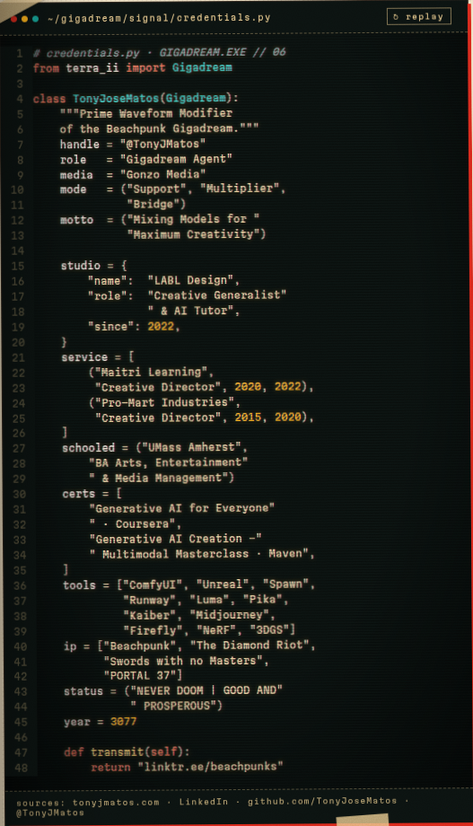

# GIGADREAM.EXE

**Tony Jose Matos — Prime Waveform Modifier of the Beachpunk Gigadream.**
Gigadream Agent + Gonzo Media · Support • Multiplier • Bridge · Mixing Models for Maximum Creativity · #beachpunk

### ▶ Live: **https://tonyjosematos.github.io/gigadream-exe/**

### 🎞 Demo

**[▶ Watch the full 14-second demo (preview.mp4)](https://tonyjosematos.github.io/gigadream-exe/preview.mp4)**: the black hole idling, ACCESS DENIED, 07 SPAWN, Signal with `credentials.py` typing out, the Lore compiler, and back home.

A one-page transmission from TERRA II. Seven petroglyph sigils sit on a hand-ruled heptagon around a black hole:
**&lt;REDACTED PROJECT&gt; — ACCESS DENIED.** Its accretion disk swirls, the lattice lines spiral into the event horizon,
and the sky behind it is gravitationally lensed. Click it and it refuses you. Pull a sigil outward (or just tap it) and its sheet slides in:

| | |
|---|---|
| **01 PROJECTS** | The GIGADREAM.EXE set: Photo Vector Bashing, PORTAL 37, Shorts in Aesthetical Accuracy, codename: beachpunk |
| **02 DEVELOPING** | The AI + engine lab, with a live excerpt of `gigadream-fieldkit/canon.py` |
| **03 LORE** | The Diamond Riot // TERRA II compiler: FRINGE POSH DARK boards, field dispatches, salvage ASCII |
| **04 OPTICS** | The Bilingual Optics Sorting Facility. Biological RGB → mechanical CMYK dials drive the sky live |
| **05 ARCHIVE** | A contact sheet of every motion test and model shoot-out, 2023 → 2026 |
| **06 SIGNAL** | Socials (LinkedIn · X · Credly), `credentials.py` with a typed-out service record, plus every link |
| **07 SPAWN** | [BeachPunk Gigadream: Lost Coast](https://www.spawn.co/@beachpunk/beachpunk-gigadream-lost-coast), the playable game on Spawn |
| **centre** | &lt;REDACTED PROJECT&gt; — access denied |

NEVER DOOM | GOOD AND PROSPEROUS | 3077 — love is the fifth element.

  
  

## Under the hood
- One self-contained `index.html`. No frameworks, no build step.
- WebGL fragment shader for the background: vector-bash shards, the horizon, an RGB↔CMYK halftone mix, and gravitational lensing around the black hole.
- SVG lattice lines with feTurbulence "boil", misregistered C/M strokes, sand-grain erosion, traveling pulses, and plucked-string vibration.
- Film layer: grain, drifting light leaks, chromatic aberration, and gate weave.
- Responsive layout (the lattice becomes a totem on phones), keyboard support, and `prefers-reduced-motion`. Animation pauses when the tab is hidden.
- Deep links: `#projects` `#developing` `#lore` `#optics` `#archive` `#signal` `#spawn`
- `preview.mp4` is a 14-second capture of the current site (1280×800, 24 fps, headless software render). `media/demo.gif` is an 8-second excerpt.

Run it locally by opening `index.html` in a browser.

## Links
- Portfolio: [tonyjmatos.com](https://tonyjmatos.com/gigadream)
- X: [@TonyJMatos](https://www.x.com/tonyjmatos/highlights)
- LinkedIn: [tony-matos-791085159](https://www.linkedin.com/in/tony-matos-791085159/)
- Credly: [gigadream](https://www.credly.com/users/gigadream/badges/credly)
- Play: [BeachPunk Gigadream: Lost Coast on Spawn](https://www.spawn.co/@beachpunk/beachpunk-gigadream-lost-coast)
- Everything: [linktr.ee/beachpunks](https://linktr.ee/beachpunks)
- Lore engine: [gigadream-fieldkit](https://github.com/TonyJoseMatos/gigadream-fieldkit) · [Bilingual-Optics-Sorting-Facility](https://github.com/TonyJoseMatos/Bilingual-Optics-Sorting-Facility)

## Credits
Art, lore, and every image © Tony Jose Matos / LABL Design. Images come from tonyjmatos.com, @TonyJMatos, and the game's public Spawn page.
Fonts: Big Shoulders Stencil, Martian Mono, Newsreader, and Reenie Beanie (Google Fonts, SIL OFL).
