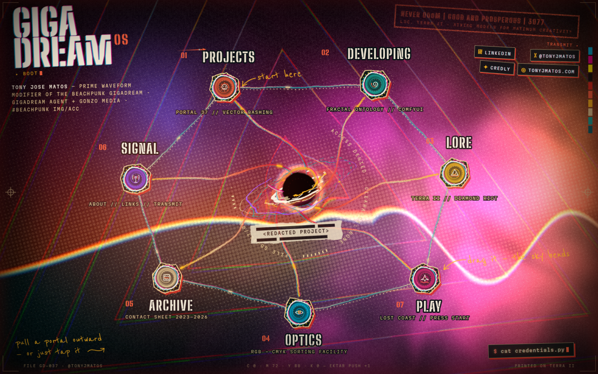
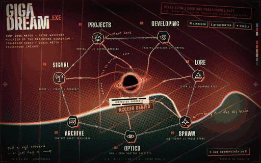
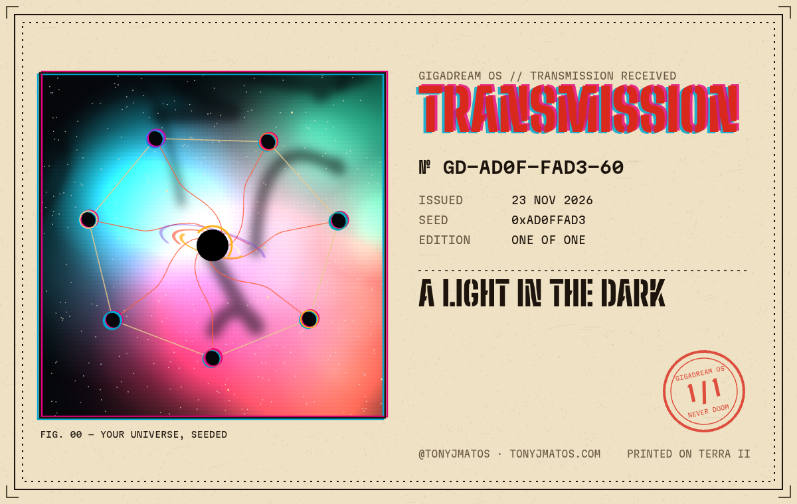
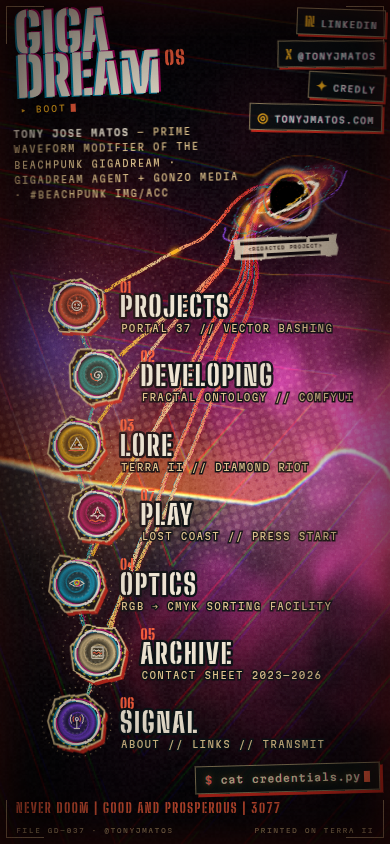

# GIGADREAM OS

**Tony Jose Matos — Prime Waveform Modifier of the Beachpunk Gigadream.**
Developer · creative operations · Gigadream Agent + Gonzo Media · Support • Multiplier • Bridge · Mixing Models for Maximum Creativity · #beachpunk

### ▶ Live: **https://tonyjosematos.github.io/gigadream-exe/**

### 🎞 Demo

**[▶ Watch the full 16-second demo (preview.mp4)](https://tonyjosematos.github.io/gigadream-exe/preview.mp4)**: GIGADREAM OS boots in four riso passes and prints a TRANSMISSION card, the black hole flashes ACCESS DENIED, the Optics spectrum sweeps from solid white to solid black, and PLAY opens.

A one-page transmission from TERRA II. Seven hand-cut stone portals sit on a hand-ruled heptagon around a black hole:
**&lt;REDACTED PROJECT&gt;.** Its accretion disk is a seeded tangle of turbulent filaments that precesses and flares, the lattice lines spiral into the event horizon,
and the sky behind it is gravitationally lensed. Click it and ACCESS DENIED flashes for a beat. Pull a portal outward (or just tap it) and its sheet slides in.

### GIGADREAM OS (the corner button)
Press **GIGADREAM OS ▸ BOOT** and the screen is reprinted like a risograph: cyan, magenta, yellow, then key, each pass slammed in slightly off-register while a boot log runs
(`GIGADREAM OS // boot 3077` · `mount portal_37` · `seed: 0x…`). It then prints a **one-of-one TRANSMISSION card** with a thumbnail of your seeded universe, a serial number, the date and a line of lore.
**SAVE PNG** keeps it. The whole site (nebula spheres, light leaks, accretion disk) re-seeds to that card's seed. With reduced motion the passes simply fade in.
Share a universe with `?seed=<hex>`.

| | |
|---|---|
| **01 PROJECTS** | The GIGADREAM.EXE set: Photo Vector Bashing, PORTAL 37, Shorts in Aesthetical Accuracy, codename: beachpunk |
| **02 DEVELOPING** | The AI + engine lab, with a live excerpt of `gigadream-fieldkit/canon.py` |
| **03 LORE** | The Diamond Riot // TERRA II compiler: FRINGE POSH DARK boards, field dispatches, salvage ASCII |
| **04 OPTICS** | The Bilingual Optics Sorting Facility. A spectrum dial runs solid white → Ektar → magenta → violet → cobalt → teal → solid black, plus nebula chaos, RGB↔CMYK, vector bash, Ektar push, and a reseed button. Hit either end: **LOVE IS THE FIFTH ELEMENT** / **A LIGHT IN THE DARK** |
| **05 ARCHIVE** | A contact sheet of every motion test and model shoot-out, 2023 → 2026 |
| **06 SIGNAL** | Four ticket stubs (LinkedIn · X · Credly · tonyjmatos.com), `credentials.py` with a typed-out service record, plus every link |
| **07 PLAY** | [BeachPunk Gigadream: Lost Coast](https://www.spawn.co/@beachpunk/beachpunk-gigadream-lost-coast), the playable game, built on Spawn |
| **centre** | &lt;REDACTED PROJECT&gt; — access denied |

NEVER DOOM | GOOD AND PROSPEROUS | 3077 — love is the fifth element.

  
  

## Under the hood
- One self-contained `index.html`. No frameworks, no build step.
- WebGL fragment shader for the background: vector-bash shards, the horizon, an RGB↔CMYK halftone mix, a domain-warped fbm galaxy nebula (seeded colour spheres, dust lanes, star speckle), gravitational lensing around the black hole, and the white↔black spectrum stage. Three noise octaves, capped pixel ratio.
- SVG lattice lines with feTurbulence "boil", misregistered C/M strokes, sand-grain erosion, traveling pulses, and plucked-string vibration.
- Portals: stone frames with misregistered CMYK rims, a breathing tinted void with a swirl, and a small pull toward the black hole on hover.
- Sky: mini starjets on random paths, and now and then one larger anomaly (comet, pulsar, lensing ripple or nebula bloom), at most one at a time.
- Film layer: grain, seeded light leaks, chromatic aberration, and gate weave.
- Responsive layout (the lattice becomes a totem on phones), keyboard support, and `prefers-reduced-motion` (no slams, no sky effects). Animation pauses when the tab is hidden.
- Deep links: `#projects` `#developing` `#lore` `#optics` `#archive` `#signal` `#play` (`#spawn` still works)
- `preview.mp4` is a 16-second capture of the current site (1280×800, 24 fps, headless software render). `media/demo.gif` is the same 16 seconds at 512 px, 8 fps.

Run it locally by opening `index.html` in a browser.

## Links
- Website: [tonyjmatos.com](https://tonyjmatos.com)
- X: [@TonyJMatos](https://www.x.com/tonyjmatos/highlights)
- LinkedIn: [tony-matos-791085159](https://www.linkedin.com/in/tony-matos-791085159/)
- Credly: [gigadream](https://www.credly.com/users/gigadream/badges/credly)
- Play: [BeachPunk Gigadream: Lost Coast, built on Spawn](https://www.spawn.co/@beachpunk/beachpunk-gigadream-lost-coast)
- Everything: [linktr.ee/beachpunks](https://linktr.ee/beachpunks)
- Lore engine: [gigadream-fieldkit](https://github.com/TonyJoseMatos/gigadream-fieldkit) · [Bilingual-Optics-Sorting-Facility](https://github.com/TonyJoseMatos/Bilingual-Optics-Sorting-Facility)

## Credits
Art, lore, and every image © Tony Jose Matos / LABL Design. Images come from tonyjmatos.com, @TonyJMatos, and the game's public Spawn page.
Fonts: Big Shoulders Stencil, Martian Mono, Newsreader, and Reenie Beanie (Google Fonts, SIL OFL).
